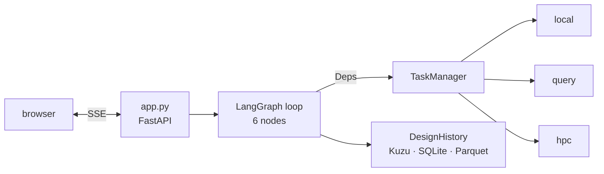

# Architecture

PEAT is four cooperating pieces: a **web frontend** that streams a conversation and renders what
it produces, an **agentic app** that decides what to do and writes every user-visible sentence, a
**task interface** layer that gets slow work off the event loop and onto the right substrate, and
a **data lake** that remembers what happened after the session ends.

They exist in that shape because of one constraint — *a chat must answer in milliseconds, a fold
takes tens of seconds, and a cluster job takes hours.* Everything below is downstream of it.

## The web frontend

`frontend/` is a React 19 application built by Vite 6, with four runtime dependencies in total:
`react`, `react-dom`, `marked` and `dompurify`. It is split into two panes.

The **chat pane** holds the conversation, the live status lines a turn emits, and a *task chip*
per unit of work. A chip names its interface whenever that interface is not `local`, so a
ProteinMPNN task reads `hpc`, and expanding it shows a streaming log tail — which only the
Orbit/PSI-J path can produce, because log streaming is a declared capability the local interfaces
do not have. Under each reply there is a **how this answer was made** disclosure: the node that
produced the text, the function inside it, and the per-node timings of the turn.

The **artifact pane** renders what a round produces: an interactive structure view, the session
summary as Markdown, the ensemble table, and a downloadable `.docx`. The viewer is
[Mol\*](https://molstar.org/) — specifically `@rcsb/rcsb-molstar`, which is **not** an npm
dependency: `frontend/src/artifacts/MolstarView.tsx` loads a pinned UMD build from a CDN at
runtime and caches the loader on `window`.

Two deliberate restrictions are worth knowing. Assistant text is model-influenced, so it is
sanitized before it is rendered. And the visualization the agent produces is a **JSON view spec**
that the frontend validates field by field, never generated JavaScript — shipping model-written
JS into the page would let a prompt put code in the browser, so a bad generation degrades to a
plain cartoon instead.

## The agentic app

`backend/designagent/app.py` is a FastAPI service: login and session routes, a Server-Sent-Events
chat endpoint, artifact and task routes, settings, and a health endpoint that reports which
degraded modes are in effect. Behind it is a LangGraph loop of six nodes.

| Node | Does | Writes to state |
| --- | --- | --- |
| **Coordinator** | Classifies the prompt, streams updates, answers from state | `intent`, `goal` |
| **Design Initializer** | PDB, UniProt and literature lookups, concurrently | `reference_design` |
| **Redesign Orchestrator** | Picks the success metric, builds and dispatches the worklist | `key_metric`, `worklist` |
| **Analyst** | Scores returns, writes the lake, ranks, rebuilds the view | `lead_design`, `ensemble`, `molecular_visualization` |
| **Interpreter** | Summarizes, flags related past designs, renders artifacts | `design_summary`, `artifacts` |
| **Protocol** | Runs one stage of the enzyme-redesign cluster pipeline per turn | `protocol` |

Five rules describe the loop more usefully than a call graph:

- **Routing is dynamic.** A node returns `Command(goto=..., update=...)`, so the routing decision
  and the state write are one atomic return; `START → coordinator` is the only static edge. A
  chat turn ends immediately, a design request loops Orchestrator → Analyst until the key metric
  stops improving or `max_rounds` is reached, then summarizes.
- **Nodes reach the outside only through `Deps`.** Settings, the task manager, the design history
  and the artifact store are injected (`graph/deps.py`); no node imports a store or an interface.
  This is the reason the 417-test offline suite needs no network, no process pool and no
  endpoint.
- **State carries no bulky payloads.** LangGraph serializes a checkpoint every turn, so
  coordinates go to a content-addressed blob and travel as a path. A test asserts that `ATOM`
  records never appear in serialized state, because the regression is otherwise invisible —
  nothing breaks, the checkpoint just grows every turn.
- **Only prose streams to the chat.** Streaming is opt-in per call, and only the two user-facing
  calls use it; the intent classifier's and round planner's JSON are explicitly suppressed, or
  they would arrive in the assistant's bubble.
- **Every user-visible sentence is attributable.** A node that authors text records a
  `reply_source` such as `interpreter:_rule_based_summary` or `coordinator:llm` — a value that
  greps straight to the function that wrote it. Without this, a reply reads identically whether a
  rule or a model produced it.

With no API key the loop still runs end to end: every node has a deterministic rule-based path,
and the key improves classification, planning and the written summary rather than enabling them.
When a key is present but rejected, the turn says so in its own reply instead of looking normal.

### The protocol node

The other five nodes serve a chat turn. `graph/nodes/protocol.py` serves a multi-day cluster
pipeline — the enzyme-redesign protocol — as **one stage per turn**: nine stages from intake
through conservation analysis, ProteinMPNN redesign, selection and AlphaFold3 to the report. It
is the only node that answers the user every turn and never routes onward.

The protocol has points where a run must stop and wait for a person, and there is no
`interrupt()` anywhere in this codebase. **The turn boundary is the checkpoint mechanism**: a
stage sets an `awaiting` key and returns, and the next message answers it. That has one visible
consequence — while a campaign is waiting, the coordinator routes to the protocol node *before*
it classifies intent at all, because answers like "liu", "310,364" and "go" would otherwise
classify as chat and leave the campaign waiting forever. A short list of escape words is the way
out.

Progress is read from the filesystem, never from a task handle. Handles are in-memory, so a
restarted server cannot re-attach to an in-flight job; the collect stage lists the output tree and
reads the small summary files instead, which makes it idempotent and identical whether the
submission was minutes or days ago. **The data outlives the handle, so recovery is a re-fetch,
not a re-attach.**

Everything a chat message contributes — a target name, a UniProt id, domain bounds, catalytic
residues, a cluster account name — ends up inside a `bash -lc` body and in paths the endpoint
writes to under the site's allocation. The input validators therefore **reject rather than
sanitize**, and the protocol's own settings are environment-only, never writable over HTTP, for
the same reason.

## The task interfaces

Task duration is indeterminate, so every interface submits asynchronously and returns a handle
carrying a future. **Nothing in the graph awaits at submission time**, and a *failed* submission
becomes a settled FAILED handle rather than an exception — so callers have exactly one shape to
handle and gathering results never raises.

| Interface | Backing | Cancel | Log stream | Push events |
| --- | --- | --- | --- | --- |
| `local` | flowgentic → asyncflow → rhapsody `ConcurrentExecutionBackend` (process pool) | yes | no | no |
| `query` | `httpx` on the main event loop (REST retrieval) | yes | no | no |
| `hpc` (Orbit) | `EndpointRuntime` with rhapsody and PSI/J plugins | yes | yes, by byte offset | yes |
| `hpc` (Globus) | `globus_compute_sdk.Executor` | only before start | no | no |

Capabilities are **declared rather than assumed**, because the two HPC backends genuinely differ.
A catalog of fourteen tasks (`tasks/registry.py`) says which interface each one belongs to and
what it produces; `TaskManager` routes a submission to the right interface, and under logins it
routes `hpc` work to the endpoint belonging to the user whose turn it is.

Three details make the remote path work and are not obvious from any single file:

- **A pool worker is handed its settings, not left to derive them.** Task bodies call for settings
  themselves and cache the answer for the worker's lifetime, so changing anything a worker reads —
  the API key above all — requires a new pool, and therefore a rebuilt runtime.
- **Staging is in band.** The broker forwards neither declared outputs nor stdin, so a spec that
  declares inputs or outputs is rewritten into a `bash -lc` script: inputs are gzipped, base64'd
  and split across argv, the real command's own chatter is pushed to stderr so stdout stays a
  clean data channel, and each output comes back as a framed block with its size and SHA-256.
  Framing is not optional — a login shell prints banners, and a stray `>` line is a valid FASTA
  header.
- **An HPC submission must carry a real job spec**, or it degrades to `/bin/true`. The
  orchestrator fills the executable, executor, account and queue from settings, and the resource
  vocabulary is renamed into PSI/J's, which answers HTTP 500 on a field it does not recognize.

Where no HPC endpoint is attached, `hpc` tasks fall back to their app-local equivalents. The
substitution is **labelled at the point it happens** — *"no HPC endpoint was attached, so the job
was never submitted"* — because an unlabelled fallback makes a heuristic round indistinguishable
from a real one. Where a real run does happen, its provenance is *read* rather than asserted: the
model name and git hash are lifted out of ProteinMPNN's own FASTA header, and a run that declares
neither earns a caveat saying so.

## The data lake, and what is shared

`backend/designagent/lake/` is a three-tier design history behind a single `DesignHistory`
facade.

| Tier | Store | Holds |
| --- | --- | --- |
| 1 | Kuzu, embedded graph | raw outputs and provenance: `Campaign`, `Reference`, `Design`, `Task`, `Output`, `Structure`, joined by relations such as `DERIVED_FROM` and `PRODUCED` |
| 2 | SQLite | scores, per-round rankings, analyses |
| 3 | Parquet plus a JSON manifest | curated golden sets, staged for ML training behind explicit curation rules |

Bulky payloads — coordinates, FASTA — go to a content-addressed blob directory and are referenced
by path from tier 1. Tiers 1 and 2 are written together so they cannot drift. Every lake write is
individually guarded: a storage failure must not lose a round the user waited two minutes for, so
ranking falls back to in-memory and the user is told in the summary's caveats.

Two operational facts follow from Kuzu being an embedded database. It takes an **exclusive file
lock**, so a second backend on the same data directory dies rather than degrading — and it sizes
its buffer pool at roughly 80% of host RAM by default, which on a small VM is most of the
machine, so there is an environment variable to cap it.

### Across sessions

This is the point of the lake. A finished round is not just a message in a transcript: designs,
tasks, outputs and scores are filed with their provenance, and a later session reads them back.
`DesignHistory.related_past_designs()` returns the best designs on the current metric *from other
campaigns*, and the interpreter surfaces them in the summary. The session summary artifact prints
the tasks a round ran, with their interface and final state, straight out of the graph store —
which is how you tell, weeks later, whether a design came off a cluster or out of a rule table.

### Across a group

With `DESIGNAGENT_AUTH_ENABLED=true`, one deployment serves several people. What is private to a
user is their account, their chat sessions — a session that is not yours returns 404, because
whether it exists is also the owner's business — and their credentials: eight fields covering an
Anthropic key and model and an Orbit broker, token, certificate, endpoint, account and queue.
Credentials are stored as Fernet ciphertext with each value cryptographically bound to its user
*and* its field, so a ciphertext copied to another row fails to decrypt rather than silently
becoming someone else's key. They are validated by rejection, and a broker must appear on an
operator-configured allow-list, because it is a host the server will dial and hand a token to.
A plain user's baseline has every operator credential removed, so nobody falls through to the
operator's key or allocation, and every path, shell and scheduler choice stays operator-only.

What is **shared, deliberately**, is everything else: one design history, one checkpointer, one
artifact store, for the whole deployment. Kuzu's exclusive lock rules out a data directory per
user, and the cross-campaign read above is a feature for a lab working on related targets. The
consequence must be stated plainly rather than discovered: **on a shared deployment, one user's
sessions can surface another user's designs.**

!!! warning "Current tenancy limits"

    The Orbit broker is shared too, and every endpoint holds the broker token — so on a shared
    broker, any user can submit work as any other user. A deployment is therefore safe for one
    user, or for a group that trusts one another, and not for mutually untrusting tenants. One
    broker per user is specified in `plans/LINODE_DEPLOY.md` (Phase 3) and is not built. The
    remaining gaps left open by the current login implementation are recorded together in
    `plans/BACKLOG.md` (*What Phase 2's logins leave open*).
