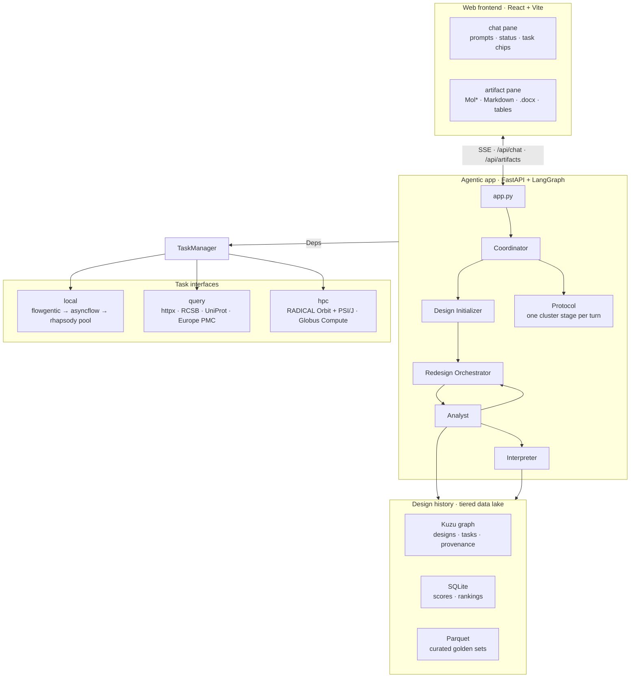

# PEAT

**Protein Engineering Agent Toolkit**

PEAT is a chat interface for protein redesign. You state a design goal in prose — *"redesign
1UBQ to improve thermostability"* — and a [LangGraph](https://github.com/langchain-ai/langgraph)
agent loads the reference structure, proposes variants, folds and scores them, ranks an ensemble
and writes the round up as an artifact you can read, download or keep working from. The slow work
does not run on the web server: it is pushed to **your** HPC allocation through **your** endpoint,
and the model calls go to **your** LLM key.

## What it is for

The whole design follows from one constraint: **a chat interface must answer in milliseconds,
while a fold takes tens of seconds and a cluster job takes hours.** Every unit of work is
therefore submitted asynchronously and returns a handle immediately; the conversation continues
while the jobs run, and the reply names what is still in flight.

A session looks like this. You name a target, and the agent retrieves its structure from the
RCSB PDB or the AlphaFold database, its annotation from UniProt and the relevant literature from
Europe PMC. You give it a goal, and it picks a success metric, dispatches a round of design work —
ProteinMPNN on the cluster where an endpoint is attached, a labelled heuristic proposer where one
is not — folds and scores what comes back, ranks an ensemble, and loops until the metric stops
improving. Then it summarizes, renders a Markdown and `.docx` report and an interactive Mol\*
view, and files every design, task and output in a tiered data lake.

What you supply is an Anthropic API key and, for real compute, a
RADICAL Orbit broker, endpoint, account and queue.
What persists is the lake: a later session, yours or a colleague's on the same deployment, reads
back the best designs from earlier campaigns and says so in its summary.

For a longer multi-day campaign there is a second mode. The **protocol node** runs an
enzyme-redesign pipeline — conservation analysis, ProteinMPNN redesign, selection, AlphaFold3
folding, report — as one cluster stage per chat turn, using the turn boundary itself as the
place a run stops and waits for a human decision.

## Features

- **Interactive design rounds.** A conversation, not a submit script: state a goal, watch the
  tasks, read the round, ask for another.
- **Bring your own LLM and HPC.** Each signed-in user supplies their own Anthropic key and their
  own Orbit broker, endpoint, account and queue; a turn runs under the credentials of the person
  who asked.
- **Three task interfaces.** `local` for CPU work in a process pool, `query` for REST retrieval
  on the event loop, `hpc` for real scheduler jobs — same submit-and-handle contract for all
  three.
- **A design history that outlives the session.** A three-tier lake — provenance graph, scores,
  curated Parquet sets — that later campaigns read back from.
- **A multi-day protocol, one stage per turn.** Nine stages with human checkpoints where the
  science needs one.
- **Honest degradation.** With no API key every node falls back to a deterministic rule-based
  path; with no endpoint, ProteinMPNN falls back to a heuristic proposer that *says so* in the
  output rather than passing itself off as a model run. Every user-visible sentence carries the
  name of the function that wrote it.

## Architecture at a glance

| Element | What it is | Where it is |
| --- | --- | --- |
| **Web frontend** | A React/Vite single page: a chat pane fed by Server-Sent Events, and an artifact pane that renders structures, Markdown, tables and `.docx` | `frontend/src/` |
| **Agentic app** | A FastAPI service wrapping a LangGraph loop of six nodes, each routing dynamically and reaching the outside world only through an injected `Deps` | `backend/designagent/app.py`, `graph/` |
| **Task interfaces** | One asynchronous submit-and-handle contract over three very different substrates: a process pool, REST APIs, and a real HPC scheduler | `backend/designagent/tasks/` |
| **Data lake** | Three tiers — an embedded Kuzu provenance graph, a SQLite score store, Parquet golden sets — plus a content-addressed blob directory for anything bulky | `backend/designagent/lake/` |

[How each of those works →](concepts/architecture.md)

## Dependencies in brief

| Layer | Built on |
| --- | --- |
| Web frontend | React 19, Vite 6, `marked` + `dompurify`; the Mol\* viewer loaded from a CDN at runtime |
| Agent loop | LangGraph 1.2, LangChain 1.4, `langchain-anthropic` |
| Web service | FastAPI, Uvicorn, Pydantic 2 and pydantic-settings, httpx |
| Data lake and artifacts | Kuzu, SQLite, PyArrow, `python-docx`, Biopython |
| Execution middleware | `flowgentic` → `radical.asyncflow` → `rhapsody`, as local editable checkouts |
| Remote HPC | `radical.orbit` (broker, endpoint, PSI/J), optionally `globus-compute-sdk` |
| External services | RCSB PDB, UniProt, Europe PMC, AlphaFold DB, ESM Atlas, Anthropic |

[The full stack, with constraints and reasons →](reference/dependencies.md)

## What runs today

!!! warning "Read this before cloning"

    - **A fresh clone cannot be built.** The four middleware packages are local editable installs
      from a `refcodes/` directory that is gitignored, so `./scripts/setup.sh` on a clean clone
      stops and tells you what is missing. See
      [Installation](getting-started/installation.md) and `plans/BACKLOG.md` (*A fresh clone
      cannot be built*).
    - **No stage of the enzyme-redesign protocol has yet run on a cluster**, so every walltime,
      core count and memory figure in `protocol/specs.py` is an estimate. The `hpc` path *itself*
      has run for real — submit, poll, tail, cancel, with the Slurm job id coming back.
    - **The Globus Compute adapter has never met a live endpoint.** It implements the same
      interface and is tested offline; that is all.
    - **The Python package and the environment prefix are still `designagent` and
      `DESIGNAGENT_`.** Nothing here imports as `peat`.
    - This is a from-scratch rewrite that shares no history with the Streamlit application that
      previously carried the name; that work is preserved on the repository's `archive/*`
      branches.

## Learn more

- [Installation](getting-started/installation.md) — the supported install path, what it refuses
  to do, and how to start the stack
- [Architecture](concepts/architecture.md) — the frontend, the agent loop, the task interfaces
  and the data lake, including what is shared between sessions and between users
- [Dependencies](reference/dependencies.md) — every layer of the stack, the pinned middleware
  revisions, and the external services the agent calls
- [The repository](https://github.com/KhareLab/PEAT) — `README.md` for the full engineering
  detail, `plans/BACKLOG.md` for every open issue with its evidence
